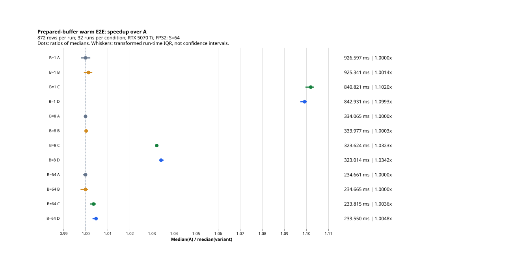
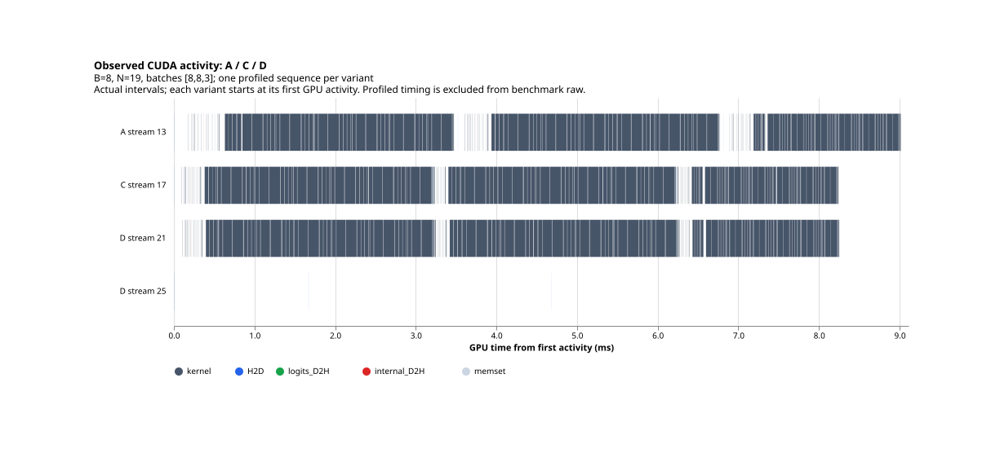
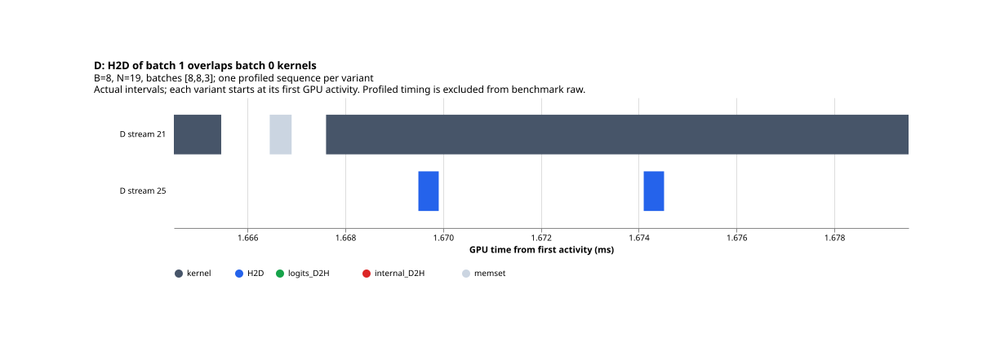

# Project 2 — 결과 분석

Session: `2026-10-25T113152.111380_0000_43aecc1c`.
Protocol SHA256: `af20bd21bbe26d2bc71d9e3bf89ca6fd52695b08a8f130d12bfa91e10754fd78`.

## 핵심 결과

384개 raw와 각 실행의 correctness, 실행 순서, 메타데이터 및 요약 산식을 감사해 모두 통과했다. 모든 logits는 finite FP32 [872,2]이며 A reference와 최대 절대오차 0.0, prediction 일치다. 전체 측정값과 더 느린 버전도 보존했다. Project 1 보호 파일 85개 해시가 유지됐다.

주 지표는 prepared-buffer warm E2E total time이다. 각 수치는 CPU 입력에서 원래 순서의 872개 CPU-visible logits 완료까지이며, 공통 최종 device synchronize를 포함한다. 모델 로딩·토큰화·pinning/버퍼/Stream/Event 준비·warm-up·correctness·파일 I/O·trace는 제외한다.

| Batch | A ms | B ms | C ms | D ms | A/C | A/D | C→D 시간 변화 |
| ---: | ---: | ---: | ---: | ---: | ---: | ---: | ---: |
| 1 | 926.597 | 925.341 | 840.821 | 842.931 | 1.1020× | 1.0993× | +0.251% |
| 8 | 334.065 | 333.977 | 323.624 | 323.014 | 1.0323× | 1.0342× | -0.188% |
| 64 | 234.661 | 234.665 | 233.815 | 233.550 | 1.0036× | 1.0048× | -0.113% |

수치는 각 조건 32회의 중앙값이다. Speedup은 같은 batch/session의 중앙값 비율이다. Throughput은 872×1000/median_ms이며 speedup 1.1020×는 throughput 약 10.20% 증가, 처리시간 약 9.26% 감소를 뜻한다. paired-run speedup이나 요청별 latency 추정이 아니다.

Whisker는 각 조건 Q1–Q3 시간을 고정한 A 중앙값으로 나눈 변환 IQR이다. 신뢰구간이나 통계적 유의성 지표가 아니다. [summary.csv](summary.csv)에 원래 시간 IQR과 throughput을 보존했다.

## A→B, B→C, C→D 해석

A→B: blocking copy를 유지하고 pinned memory만 사용했을 때 변화가 매우 작았다. A/B 중앙값 비율은 batch 1/8/64에서 각각 1.001357×, 1.000263×, 0.999982×. Pinned memory 단독의 큰 이득은 이 workload에서 관찰되지 않았다.

B→C: 같은 pinned memory에서 명시적 blocking copy의 Host 대기를 줄인 C가 가장 큰 변화를 보였다. B/C 중앙값 비율은 각각 1.100521×, 1.031991×, 1.003638×. 작은 batch에서 개선이 컸다. 이 차이는 Python 제출, 복사 API와 동기화 경로가 함께 달라진 결과이며 순수 PCIe 전송시간이 아니다.

C→D: 두 Stream과 Event 파이프라인을 추가해도 추가 효과는 작았고 batch 1에서는 D가 약 0.251% 느렸다. batch 8/64에서는 D의 중앙값 시간이 C보다 약 0.188%/0.113% 낮았다. 이는 단일 session의 기술 통계이며 작은 차이의 일반적 우위나 유의성을 주장하지 않는다.

## Trace에서 확인한 사실

별도 B=8,N=19의 [8,8,3] 한 sequence를 A/C/D 각각 수집했다. 각 trace에는 forward kernel 366개, 입력 H2D 6개, logits D2H 3개가 있다. CUDA correlation을 CPU batch marker에 연결해 GPU interval의 실제 교집합을 계산했다. 전체 forward envelope 내부의 공백을 overlap으로 세지 않았다.

| 버전 | Compute Stream | H2D Stream | H2D 합계 μs | 실제 kernel과 overlap μs | Host stream sync 호출 | forward 내부 sync |
| :---: | ---: | ---: | ---: | ---: | ---: | ---: |
| A | 13 | 13 | 2.111 | 0.000 | 12 | 3 |
| C | 17 | 17 | 3.808 | 0.000 | 3 | 3 |
| D | 21 | 25 | 2.560 | 1.408 | 3 | 3 |

D에서 다음 batch의 H2D가 이전 forward kernel과 실제로 겹쳤다. batch 1 입력 두 복사의 overlap 약 0.832 μs, batch 2 입력 두 복사의 overlap 약 0.576 μs, 합계 약 1.408 μs다. A/C의 같은 종류 overlap은 0이다. D의 slot 0 재사용과 각 forward 시작 전 upload 완료도 trace에서 확인했다. 이 관찰은 B=8,N=19 한 trace에 한정되며 full 872-row 실행이나 다른 batch의 overlap 양을 추정하지 않는다.

Trace에는 C/D에도 forward마다 1-byte D2H와 Host stream sync가 하나씩 남아 있다. CPU 연산은 aten::is_nonzero → aten::item → aten::_local_scalar_dense로 식별됐다. C/D는 runner의 명시적 blocking copy 대기를 제거하지만 모델 내부 동기화까지 제거하는 구현은 아니다. 이를 바꾸는 모델/커널 최적화는 이번 범위에 추가하지 않았다.

프로파일러의 cycle 경고는 각 새 profiler 인스턴스의 단일 capture 결과에 대해 모든 9개 batch marker와 CUDA 활동이 존재함을 확인한 뒤 판단했다. Trace 시간과 Host wait 합계는 instrumentation 영향을 받으며 benchmark raw와 합치지 않는다.

## 준비 비용과 해석 한계

Pinned variant는 각 899,904 B의 전체 입력+출력을 준비한다. 입력 892,928 B, 출력 6,976 B다. 각 variant의 host allocation/pinning/copy 및 buffer/Stream/Event 준비 비용은 [setup_costs.csv](setup_costs.csv)에 별도 기록했다. 매 batch pinning/staging은 없고 이 비용은 주 timer 밖이다. 따라서 결과를 입력 공급·준비나 시작 비용까지 포함한 application E2E라고 부르지 않는다.

Batch 64의 한 full batch 입력 H2D는 65,536 B, logits D2H는 512 B로 작다. B=8 trace에서도 실제 copy 자체는 짧았다. 관측한 중첩 양이 작고 Event/제출 비용도 있으므로 overlap 달성이 큰 E2E 개선으로 이어지지 않을 수 있다는 해석과 일치한다. 어느 요인이 정확히 얼마를 설명하는지 또는 전체 성능 상한은 이 증거로 단정하지 않는다.

한 RTX 5070 Ti, 한 model/dataset, FP32/S=64, 한 session의 결과다. 각 batch별 순서는 균형화되어 각 variant가 각 position에 8회씩 등장한다. Batch 순서는 1→8→64로 고정되어 있고 전체 session의 온도/clock 이력은 수집하지 않았다. 다른 GPU 작업의 부재, GPU 포화·occupancy·대역폭 병목 또는 여러 날의 재현성을 주장하지 않는다. Project 1의 다른 GPU·출력 계약 수치는 speedup 분모로 사용하지 않았다.

## 감사 및 재현

- [전체 결과 감사](audit.json): 384 raw, 12 coverage, 실제 CPU reference 3개, 해시·gate·순서·모든 요약 산식 검증.
- [Trace 감사](../../diagnostics/aaaea78b1d90460c91df9e18816974a5_trace/trace_audit.json): 원본 trace hash, CUDA correlation, 실제 interval 교집합.
- [비교 산식](comparisons.csv), [그래프 사양](plots/speedup.vega.json), [후처리 provenance](report_metadata.json).
- 실행 코드는 변경하지 않았다. 추가한 감사/그림 코드만 별도로 hash를 기록했다. 전체 correctness/benchmark를 재실행하지 않았다.

결론: 이 조건에서는 명시적 Host 대기 감소(C)의 이득이 주로 작은 batch에서 나타났다. D의 실제 overlap은 확인됐지만 C보다 큰 추가 성능 이득은 관찰되지 않았다. 더 느린 D의 batch 1 결과도 유효한 결과로 보존했다.
